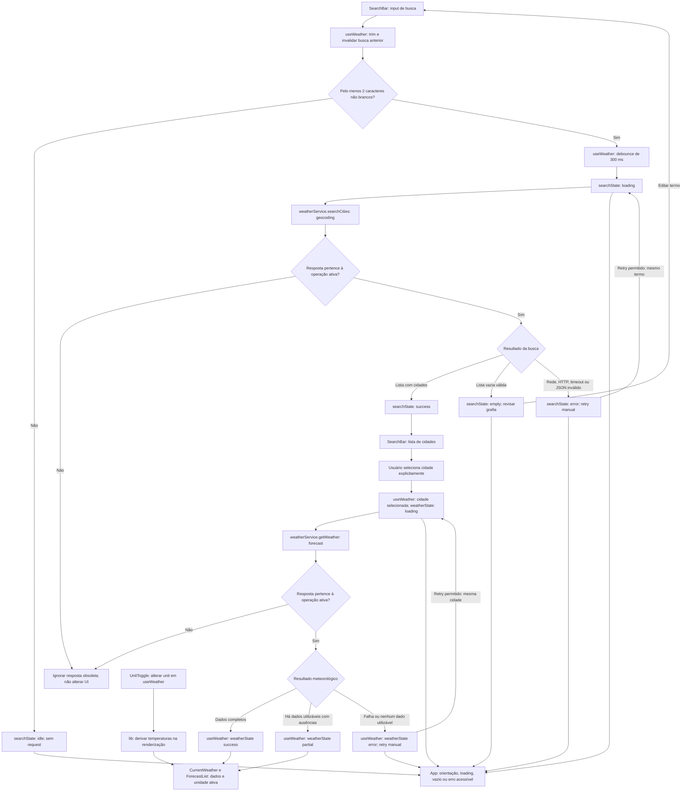

# Weather App — Plano Técnico

| Campo | Valor |
| --- | --- |
| Versão | 0.1 (rascunho) |
| Fonte da verdade | [`../specs/weather-app-spec.md`](../specs/weather-app-spec.md), versão 0.2 |
| Status | Plano provisório; resolver os bloqueios da spec antes de aprovar tarefas ou liberar a aplicação |

Este plano define arquitetura, decisões e contratos de dados, não a implementação final. Requisitos e critérios da spec prevalecem; qualquer mudança aprovada deve atualizar a spec e este plano antes da implementação.

## Architecture

Aplicação web client-side, sem backend próprio. A UI React consome uma camada de serviços que encapsula Open-Meteo e converte as respostas externas para o modelo interno. Componentes não conhecem URLs, parâmetros nem o formato bruto do provedor.

```text
React UI
  App + componentes de apresentação
           │ ações e estados observáveis
           ▼
       useWeather
  busca, seleção, unidade,
  loading, retry e cancelamento
           │ contratos de domínio
           ▼
      weatherService
  fetch + validação + normalização
      ┌────┴────┐
      ▼         ▼
 Geocoding   Forecast API
  Open-Meteo  Open-Meteo
```

- **Apresentação:** componentes focados em formulário, resultados, clima atual, previsão, unidade e estados de consulta.
- **Orquestração:** um hook mantém estado local da tela e coordena as operações independentes de geocodificação e previsão.
- **Dados:** serviços sem dependência de React fazem requisições, validam respostas e traduzem DTOs externos para tipos de domínio.
- **Funções puras:** conversão de temperatura, formatação pt-BR e catálogo de condições WMO ficam fora do componente.
- **Sem persistência:** não usar backend, banco, `localStorage`, `sessionStorage`, cache de aplicação ou analytics na v1 (D4, RNF7, RNF8, AS-8, AS-12).

## Tech Stack

| Decisão | Escolha | Justificativa / rastreabilidade |
| --- | --- | --- |
| Linguagem | TypeScript strict | Tipos para contratos internos e respostas parciais; stack do projeto. |
| UI | React 19 | Componentes funcionais e hooks, conforme stack e convenções do repositório. |
| Build e desenvolvimento | Vite | Ferramenta existente no projeto; aplicação web responsiva (AS-1). |
| Estilo | Tailwind CSS | Stack e instruções existentes; tema escuro é premissa sujeita a OQ-14. |
| Dados | `fetch` nativo | Suficiente para dois endpoints; suporta `AbortSignal` sem adicionar cliente HTTP. |
| Estado remoto | Hook React local; sem biblioteca de cache | Uma cidade por vez (AS-2), sem cache nem persistência (RNF7, AS-8); evita estado e dependências desnecessários. |
| Testes unitários | Vitest + Testing Library | Ferramentas configuradas no repositório; testar comportamento e funções puras. |
| Testes E2E | Playwright | Ferramenta configurada; interceptar rede para previsibilidade e cobrir viewport mobile. |
| Lint e formatação | Biome | Ferramenta e scripts já configurados. |
| Gerenciador | pnpm | Gerenciador suportado pelo repositório. |

Não introduzir Redux, TanStack Query, roteador, backend, cliente HTTP ou biblioteca de datas sem necessidade aprovada. Para acessibilidade automatizada, a spec exige axe; a dependência ainda não consta no manifesto atual. Confirmar no planejamento de tarefas a inclusão de uma integração compatível com Playwright, sem substituir a revisão manual.

## Project Structure

Estrutura proposta, alinhada ao README e às convenções existentes:

```text
src/
├── components/
│   ├── states/                 # Estados visuais de loading, vazio e erro
│   ├── SearchBar.tsx           # Campo, lista e seleção de cidades
│   ├── CurrentWeather.tsx      # Clima atual
│   ├── ForecastList.tsx        # Previsão de cinco dias
│   ├── ForecastCard.tsx        # Um dia da previsão
│   └── UnitToggle.tsx          # Controle °C/°F
├── hooks/
│   └── useWeather.ts           # Estado da tela e coordenação das consultas
├── services/
│   └── weatherService.ts       # Endpoints, parsing e normalização Open-Meteo
├── lib/
│   ├── temperature.ts          # Conversão e arredondamento
│   ├── format.ts               # Datas, horários e números em pt-BR
│   └── weatherCodes.ts         # Catálogo WMO pt-BR e fallback
├── types/
│   └── weather.ts              # Tipos compartilhados de domínio e serviço
└── App.tsx                     # Composição da tela

tests/
├── unit/                       # Componentes, hook, serviço e funções puras
└── e2e/                        # Fluxos de usuário com rede interceptada
```

Separar arquivos adicionais apenas quando houver uma responsabilidade real; não criar camada genérica de repositórios ou abstração de cliente HTTP para dois endpoints.

## Data Model

Tipos de domínio propostos. São contratos, não código final. Usar `null` quando o provedor não fornecer valor utilizável; não substituir ausência por zero ou texto localizado no modelo.

```ts
type Unit = "celsius" | "fahrenheit";
type LocalDate = string; // ISO local YYYY-MM-DD, sem conversão pelo fuso do dispositivo
type LocalDateTime = string; // Hora de leitura retornada no fuso pedido à API
type WeatherIconKey =
  | "clear"
  | "partly-cloudy"
  | "overcast"
  | "fog"
  | "drizzle"
  | "rain"
  | "snow"
  | "rain-showers"
  | "snow-showers"
  | "thunderstorm"
  | "thunderstorm-hail"
  | "unknown";

interface City {
  id: number;
  name: string;
  admin1: string | null;
  country: string | null;
  countryCode: string | null;
  latitude: number;
  longitude: number;
  timezone: string;
}

interface CurrentWeather {
  temperatureC: number | null;
  weatherCode: number | null;
  observedAt: LocalDateTime | null;
  relativeHumidityPercent: number | null;
  windSpeedKmh: number | null;
  precipitationMm: number | null;
  precipitationIntervalSeconds: number | null;
  surfacePressureHpa: number | null;
}

interface ForecastDay {
  date: LocalDate;
  minC: number | null;
  maxC: number | null;
  weatherCode: number | null;
  precipitationProbabilityPercent: number | null;
}

interface WeatherData {
  city: City;
  current: CurrentWeather | null;
  days: ForecastDay[]; // Exatamente cinco datas locais, em ordem.
}

interface WeatherCondition {
  description: string;
  icon: WeatherIconKey; // Chave interna; nunca texto recebido do provedor.
}

type SearchState =
  | { status: "idle" }
  | { status: "loading"; query: string }
  | { status: "success"; query: string; cities: City[] }
  | { status: "empty"; query: string }
  | { status: "error"; query: string; error: RequestError };

type WeatherState =
  | { status: "idle" }
  | { status: "loading"; city: City }
  | { status: "success"; city: City; data: WeatherData }
  | { status: "partial"; city: City; data: WeatherData }
  | { status: "error"; city: City; error: RequestError };

type RequestErrorKind =
  | "network"
  | "timeout"
  | "http"
  | "invalid-response"
  | "no-usable-data";

interface RequestError {
  kind: RequestErrorKind;
  retryAt: number | null; // Epoch ms quando Retry-After válido; null se retry for imediato.
}

interface WeatherService {
  searchCities(query: string, signal: AbortSignal): Promise<City[]>;
  getWeather(city: City, signal: AbortSignal): Promise<WeatherData>;
}
```

- `SearchState.empty` representa resposta bem-sucedida sem resultados; nunca é erro.
- `WeatherState.partial` representa ao menos um dado meteorológico utilizável, com valores/seções ausentes marcados como indisponíveis na apresentação. Se não houver dado utilizável em nenhuma seção, o serviço rejeita com `no-usable-data`.
- `WeatherData` agrega a cidade selecionada e o forecast; não é um DTO do provedor. `current: null` representa a seção atual inteira indisponível. O fuso de `observedAt` é `WeatherData.city.timezone`. `Unit` e `WeatherData` incorporam os nomes da proposta de interfaces, substituindo `TemperatureUnit` e `WeatherSnapshot` da primeira versão do plano.
- O modelo normalizado mantém medidas em Celsius (`temperatureC`, `minC`, `maxC`). A unidade escolhida é estado de apresentação; a conversão parte do valor original e ocorre sem nova requisição (RF4, AC-4.2, AC-4.6–4.8).
- A cidade retém `timezone` IANA da geocodificação. Tratar fuso ausente ou inválido exige decisão explícita antes da implementação, pois a spec não define fallback.
- O dia e o código de condição podem estar ausentes; `days` ainda representa cinco datas locais, com campos numéricos ou código nulos nos dias incompletos (RF3.5, RF5.5).
- O catálogo de códigos cobre códigos WMO documentados pelo provedor, com descrição pt-BR e ícone. Código desconhecido usa descrição "Condição indisponível" e ícone neutro (AC-2.3, AC-3.7).
- Os nomes de tipos externos devem deixar claro que são DTOs e permanecer privados ao serviço. Componentes consomem apenas os tipos normalizados acima.

### Ícones locais

Na implementação isolada P6.4/P6.5, `getWeatherCondition` retorna o símbolo Unicode
local diretamente em `icon: string`, em vez da chave conceitual `WeatherIconKey`
abaixo. A descrição também fornece o nome acessível; não há dependência de imagens
ou biblioteca externa. A tabela continua sendo o catálogo semântico.

### Apresentação diária autorizada em P6.5

`ForecastCard` recebe `{ day: ForecastDay, unit: Unit, today: string }`;
`ForecastList` recebe `{ days: readonly ForecastDay[], unit: Unit, today: string }`.
`today` é a data civil YYYY-MM-DD da cidade, fornecida pela camada de estado futura,
nunca inferida do fuso do dispositivo pelo componente. `formatForecastDay(date, today)`
formata datas civis via UTC apenas para evitar deslocamento, com dia da semana,
dia/mês e "Hoje" quando iguais. Datas inválidas lançam `RangeError`; a normalização
do serviço deve entregar datas válidas e cinco registros únicos em ordem.

A lista preserva ordem e lacunas recebidas, usa chave por data e grid
`grid-cols-2 sm:grid-cols-3 lg:grid-cols-5`; lista vazia comunica indisponibilidade.
O card deriva temperaturas com `formatTemperature`, mantém probabilidade em % e
indica valores ausentes/inválidos como indisponíveis. O serviço futuro deve incluir
`precipitation_probability_max` em `daily`. A fixture conserva esse novo campo em
`null`, sem fabricar medições. AC-3.8 cobre a probabilidade.

### Catálogo WMO proposto

A spec exige cobertura integral dos códigos documentados. A tabela define as descrições pt-BR e chaves de ícones; códigos não listados usam `unknown` e "Condição indisponível". Cada código agrupado deve ter seu próprio caso de teste. Os códigos 2, 61 e 80 preservam os textos das fixtures da spec.

| Código WMO | Descrição pt-BR | `WeatherIconKey` |
| --- | --- | --- |
| 0 | Céu limpo | `clear` |
| 1 | Predominantemente limpo | `clear` |
| 2 | Parcialmente nublado | `partly-cloudy` |
| 3 | Nublado | `overcast` |
| 45 | Nevoeiro | `fog` |
| 48 | Nevoeiro com deposição de geada | `fog` |
| 51 / 53 / 55 | Garoa fraca / moderada / intensa | `drizzle` |
| 56 / 57 | Garoa congelante fraca / intensa | `drizzle` |
| 61 / 63 / 65 | Chuva fraca / moderada / intensa | `rain` |
| 66 / 67 | Chuva congelante fraca / intensa | `rain` |
| 71 / 73 / 75 | Neve fraca / moderada / intensa | `snow` |
| 77 | Grãos de neve | `snow` |
| 80 / 81 / 82 | Pancadas de chuva fracas / moderadas / violentas | `rain-showers` |
| 85 / 86 | Pancadas de neve fracas / intensas | `snow-showers` |
| 95 | Trovoadas | `thunderstorm` |
| 96 / 99 | Trovoadas com granizo fraco / intenso | `thunderstorm-hail` |

O código preserva a intensidade na descrição mesmo quando o ícone é compartilhado. Não acrescentar `is_day` ou variantes noturnas: não são necessárias ao mínimo especificado. Usar ícones locais com alternativa textual, sem carregar um serviço externo de ícones (AC-2.1, RNF7).

## Data Flow

### Diagrama de fluxo

Os nós de estado pertencem à mesma instância de `useWeather`; os serviços apenas retornam dados ou falhas, sem importar o hook. Toda resposta passa pela verificação da operação ativa antes de atualizar a UI.



Retry só é permitido fora de loading e após `retryAt`, quando houver prazo válido de HTTP 429; liberar o botão não envia request. Timeout termina em error e invalida a tentativa; cancelamento por edição, nova seleção ou desmontagem não gera erro exibível. Campo vazio limpa apenas a busca, preservando a cidade selecionada e seus dados (AC-1.12). A alternância de unidade não tem caminho para os serviços (RF4).

### Sequência detalhada

1. A tela inicia sem requisição e mostra orientação inicial (RF5.1, AC-5.1). Unidade começa em Celsius; nenhum estado é restaurado de armazenamento.
2. O campo de busca mantém o texto digitado. O hook só agenda geocodificação quando houver ao menos dois caracteres não brancos e 300 ms sem digitação; remove espaços das extremidades antes de enviar (RF1.5, AS-6).
3. O serviço recebe o termo e um `AbortSignal`, constrói a URL com `URLSearchParams`, trata a resposta HTTP e normaliza resultados. A UI exibe apenas campos disponíveis; usuário seleciona explicitamente uma cidade.
4. Ao editar ou limpar o termo, resultados antigos deixam de ser selecionáveis. Uma resposta antiga ou de requisição cancelada não pode mudar a lista atual (RF1.6, AC-1.5, AC-1.12).
5. Ao selecionar uma cidade, o hook torna-a o contexto atual e chama `getWeather`. Uma seleção mais recente invalida a requisição meteorológica anterior; nenhuma resposta obsoleta pode substituir os novos dados (AC-1.11).
6. O serviço solicita clima atual e previsão diária; valida e normaliza campos. Na resposta bruta, cada índice de `daily.time` identifica a data dos valores no mesmo índice dos arrays diários. Após construir esses registros, associa-os à grade de cinco datas pela data local, nunca pela posição esperada na UI, e preenche lacunas sem deslocar dados (RF3.5, AC-5.7).
7. Dados válidos são renderizados; campos ou dias inválidos são apresentados como indisponíveis. O conjunto sem nenhum dado utilizável é erro com retry, não sucesso vazio (RF5.5, AC-5.12–5.16).
8. A alternância °C/°F apenas atualiza apresentação a partir dos valores normalizados em Celsius. Não refaz buscas ou previsão e continua aplicável se ocorrer durante loading (RF4).
9. Ações explícitas de retry repetem o mesmo termo ou a mesma cidade. Erros e estados são anunciados sem mover o foco (RF5.4–5.8, RNF2).

## External APIs

Referências: [Geocoding API](https://open-meteo.com/en/docs/geocoding-api) e [Weather Forecast API](https://open-meteo.com/en/docs). Exemplos abaixo são **ilustrativos e resumidos**, com datas e valores das fixtures da spec; não são capturas de consultas reais nem previsão meteorológica verificada.

### Geocoding — Open-Meteo

**URL:** `GET https://geocoding-api.open-meteo.com/v1/search` — atende RF1 e fornece a localização para RF2/RF3.

| Parâmetro | Valor / uso |
| --- | --- |
| `name` | Nome digitado, com trim e codificação por `URLSearchParams`; preservar acentos, hífens e apóstrofos. |
| `language` | `pt`; pede nomes traduzidos quando disponíveis. O provedor pode retornar nomes em inglês ou no idioma local quando não houver tradução. |
| `count` | Limite de resultados, entre 1 e 100 no provedor (padrão 10). Valor da aplicação pendente em OQ-13. |
| `format` | `json`, explicitamente para fixar o formato esperado. |
| `countryCode` | Filtro opcional de país; não enviar na v1 para permitir cidades de qualquer país (AS-14). |

`current`, `daily` e `timezone` não são parâmetros desta busca. O fuso é um campo de cada resultado.

Exemplo de URL (o uso de `count=5` é apenas ilustrativo, não decisão de produto):

```text
https://geocoding-api.open-meteo.com/v1/search?name=S%C3%A3o%20Paulo&language=pt&count=5&format=json
```

Exemplo resumido de resposta:

```json
{
  "results": [
    {
      "id": 3448439,
      "name": "São Paulo",
      "latitude": -23.5475,
      "longitude": -46.6361,
      "timezone": "America/Sao_Paulo",
      "country_code": "BR",
      "country": "Brasil",
      "admin1": "São Paulo"
    }
  ]
}
```

Mapeamento de cada item de `results` para `City`:

| Campo da resposta | Campo do modelo | Regra |
| --- | --- | --- |
| `id`, `name` | `id`, `name` | Identidade e nome; não sintetizar valores ausentes. |
| `latitude`, `longitude` | `latitude`, `longitude` | Coordenadas usadas na requisição de forecast. |
| `timezone` | `timezone` | Identificador IANA para a consulta e interpretação de datas/horários. |
| `admin1`, `country` | `admin1`, `country` | Campos opcionais do provedor; normalizar ausência para `null`. |
| `country_code` | `countryCode` | Renomear; ausência vira `null`. |

Não exibir separadores vazios para estado/país ausentes (AC-1.8). Resposta válida sem `results` ou com `results: []` significa nenhum resultado; um campo `results` presente em formato inválido não deve ser convertido em lista vazia. Erros HTTP ou corpo ilegível são falha com retry, não empty (AC-5.3, AC-5.4).

O mínimo de dois caracteres e debounce de 300 ms são regras da aplicação (AS-6). Não implementar correção de grafia local: OQ-13 ainda define limite do termo, quantidade/ordenação de resultados e homônimas indistinguíveis. Tratamento de resultados com identidade, coordenadas ou fuso inválidos também precisa de regra explícita; não descartá-los silenciosamente nem fabricar dados.

### Forecast — Open-Meteo

**URL:** `GET https://api.open-meteo.com/v1/forecast` — uma requisição atende clima atual e previsão diária (RF2/RF3).

| Parâmetro | Valor / uso |
| --- | --- |
| `latitude`, `longitude` | Coordenadas da `City` selecionada. |
| `current` | `temperature_2m,weather_code,relative_humidity_2m,wind_speed_10m,precipitation,surface_pressure`: campos aprovados em P6.4. |
| `daily` | `temperature_2m_min,temperature_2m_max,weather_code,precipitation_probability_max`: mínima, máxima, condição e probabilidade máxima diária de precipitação (%). |
| `timezone` | `city.timezone`, por exemplo `America/Sao_Paulo`; não usar o fuso do dispositivo. |
| `temperature_unit` | `celsius`; a troca para Fahrenheit acontece na apresentação sem nova requisição (RF4). |
| `forecast_days` | `5`: hoje e os quatro dias seguintes. |
| `timeformat` | `iso8601`: datas e horários locais; não adicionar `Z` aos horários retornados. |

Não solicitar `hourly` ou sensação térmica. P6.4 aprova as quatro métricas atuais de RF2.3: mapear `relative_humidity_2m` → `relativeHumidityPercent`, `wind_speed_10m` → `windSpeedKmh` (enviar `wind_speed_unit=kmh`), `precipitation` → `precipitationMm` (enviar `precipitation_unit=mm`), `surface_pressure` → `surfacePressureHpa`; `current.interval` → `precipitationIntervalSeconds`. Todos são nullable; precipitação sem intervalo positivo válido é indisponível. Os exemplos seguintes são ilustrativos; não são capturas reais.

Exemplo de URL:

```text
https://api.open-meteo.com/v1/forecast?latitude=-23.5475&longitude=-46.6361&current=temperature_2m,weather_code,relative_humidity_2m,wind_speed_10m,precipitation,surface_pressure&daily=temperature_2m_min,temperature_2m_max,weather_code,precipitation_probability_max&timezone=America%2FSao_Paulo&temperature_unit=celsius&wind_speed_unit=kmh&precipitation_unit=mm&forecast_days=5&timeformat=iso8601
```

Exemplo resumido e ilustrativo de resposta (não capturado da API; novas métricas
nulas preservam a ausência de medidas na fixture de referência):

```json
{
  "timezone": "America/Sao_Paulo",
  "utc_offset_seconds": -10800,
  "current_units": {
    "time": "iso8601",
    "interval": "seconds",
    "relative_humidity_2m": "%",
    "wind_speed_10m": "km/h",
    "precipitation": "mm",
    "surface_pressure": "hPa",
    "temperature_2m": "°C",
    "weather_code": "wmo code"
  },
  "current": {
    "time": "2026-10-29T09:45",
    "interval": 900,
    "relative_humidity_2m": null,
    "wind_speed_10m": null,
    "precipitation": null,
    "surface_pressure": null,
    "temperature_2m": 25,
    "weather_code": 2
  },
  "daily_units": {
    "time": "iso8601",
    "precipitation_probability_max": "%",
    "temperature_2m_min": "°C",
    "temperature_2m_max": "°C",
    "weather_code": "wmo code"
  },
  "daily": {
    "time": ["2026-10-29", "2026-10-30", "2026-10-31", "2026-11-01", "2026-11-02"],
    "precipitation_probability_max": [null, null, null, null, null],
    "temperature_2m_min": [18, 17, 16, 15, 17],
    "temperature_2m_max": [27, 26, 24, 22, 25],
    "weather_code": [2, 61, 3, 0, 80]
  }
}
```

Mapeamento para `CurrentWeather`, `ForecastDay` e `WeatherData`:

| Origem | Destino | Regra |
| --- | --- | --- |
| Cidade selecionada no geocoding | `WeatherData.city` | Preservar a identidade da cidade; coordenadas do forecast podem representar a célula do modelo, não uma nova cidade. |
| `current.temperature_2m` | `current.temperatureC` | Número finito em Celsius, sem arredondar no domínio; ausência/inválido vira `null`. |
| `current.weather_code` | `current.weatherCode` | Código WMO; ausência/inválido vira `null`; código numérico desconhecido permanece para fallback. |
| `current.time` | `current.observedAt` | Horário local da leitura, interpretado com `city.timezone`; não usar hora da requisição ou do dispositivo. |
| Seção `current` ausente/sem dados utilizáveis | `WeatherData.current = null` | Manter previsão válida disponível (AC-5.14). Campo isolado ausente não elimina os demais campos atuais (AC-5.12). |
| `daily.time[i]` | `days[].date` | Data local que identifica o registro diário. |
| `daily.temperature_2m_min[i]` | `days[].minC` | Valor do mesmo índice bruto; ausência/inválido vira `null`. |
| `daily.temperature_2m_max[i]` | `days[].maxC` | Valor do mesmo índice bruto; ausência/inválido vira `null`. |
| `daily.precipitation_probability_max[i]` | `days[].precipitationProbabilityPercent` | Mesmo índice/data; número finito entre 0 e 100 (%), inclusive; ausente/inválido vira `null`. Não confundir probabilidade com volume mm. |
| `daily.weather_code[i]` | `days[].weatherCode` | Código do mesmo índice bruto; descrição e ícone são derivados no cliente. |
| `current_units`, `daily_units` | Validação do contrato | Conferir Celsius antes de atribuir medidas aos campos `*C`; não apresentar medidas de outra unidade como Celsius. |
| `timezone`, `utc_offset_seconds` | Metadados externos | Conferir o fuso da resposta; não substituir o identificador IANA por um offset fixo, que não descreve transições de horário. |

**Arrays paralelos e associação por data:** a API associa `daily.time[i]` aos valores dos outros arrays no índice `i`. Primeiro construir registros com essa associação; depois indexá-los por data e preencher a grade de hoje local + quatro dias. Isso atende RF3.5: o índice bruto não define o dia na UI. Se faltar 30/10, o registro de 31/10 continua em 31/10; 30/10 recebe campos `null`. Não remover valores nulos antes de combinar os arrays, pois isso deslocaria os dados. Array truncado produz campos ausentes, nunca realinhamento por suposição.

`WeatherData.days` deve ter cinco datas consecutivas em ordem; hoje é calculado no fuso da cidade no momento da resposta (EC-16). `daily.time` é data civil, não instante UTC: não usar parsing que a converta implicitamente pelo fuso do dispositivo. A política para datas duplicadas/inválidas, mínima maior que máxima e a definição completa de dados utilizáveis permanecem pendentes na spec; não inventar correções.

`Unit` não é campo da resposta: é a preferência de apresentação em memória, inicializada como `"celsius"`. Descrições como "Parcialmente nublado" e ícones vêm do catálogo local de códigos WMO, não do JSON.

### Falhas e restrições comuns

- Ambos os endpoints usam HTTPS e não exigem API key conforme D1; não introduzir proxy/backend na v1. Licença, limites e eventual uso comercial dependem de OQ-9.
- Verificar HTTP antes de normalizar. O provedor pode devolver erro como `{"error": true, "reason": "..."}`; `reason` é detalhe técnico e não deve aparecer diretamente na UI (RF5.4, RNF9).
- Rede, timeout de 10 s, HTTP não-2xx ou corpo ilegível geram erro explícito e retry manual. Para 429, respeitar `Retry-After` válido quando disponível; sem prazo válido, permitir nova tentativa manual imediata (OQ-17).
- Na resposta meteorológica, preservar campos/seções válidos. Se nenhuma seção contiver dados utilizáveis, gerar `no-usable-data`, não sucesso vazio nem temperaturas zero (AC-5.16).
- Crédito ao provedor permanece visível em todos os estados (AC-6.1–6.2), sujeito ao texto e obrigações definidos em OQ-9.

## State Management

Estado local em `useWeather`, sem store global:

| Estado | Responsabilidade |
| --- | --- |
| `query` | Texto controlado do campo; não confundir com o termo da requisição ativa. |
| `searchState` | Ciclo de vida da busca: idle, loading, success, empty ou error. |
| `weatherState` | Ciclo de vida da previsão para a cidade selecionada: idle, loading, success, partial ou error. |
| `unit` | Celsius ou Fahrenheit, inicializado em Celsius e mantido só na memória da página. |

- `App` chama o hook uma vez. Componentes recebem dados e callbacks; não mantêm cópias de cidade, temperaturas ou unidade. Apenas estado visual, como abertura da lista e item ativo do teclado, permanece local ao componente.
- `selectedCity` é derivada de `weatherState`: `null` em idle e a cidade da operação nos demais estados. Em success/partial, a cidade de `WeatherData` deve ser a mesma da operação; não pode ser alterada independentemente.
- Não armazenar booleanos paralelos (`isLoading`, `hasError`, `isEmpty`): derivá-los do discriminante `status`, evitando combinações impossíveis.

### Estados explícitos e transições

| Estado | Busca de cidades | Consulta meteorológica |
| --- | --- | --- |
| `idle` | Inicial, campo vazio/curto ou termo aguardando debounce; sem mensagem de falha ou ausência de resultados. | Nenhuma cidade selecionada; orientação inicial, sem requisição. |
| `loading` | Requisição enviada para o termo atual, com campo editável. | Cidade selecionada em destaque, consulta em andamento; não exibir dados da cidade anterior. |
| `success` | Resposta válida com uma ou mais cidades; lista aguarda seleção explícita. | Dados completos da cidade selecionada disponíveis. |
| `empty` | Resposta válida sem cidades; sugerir revisar grafia, sem retry. | Não existe: ausência total de dados meteorológicos é error, não empty. |
| `partial` | Não existe como estado da busca; resultados inválidos dependem da regra pendente na spec. | Há dados utilizáveis, mas algum campo/dia/seção está indisponível; preservar o restante. |
| `error` | Rede, HTTP, timeout ou resposta inválida; retry do termo que falhou. | Falha da consulta ou nenhuma seção utilizável; preservar identificação da cidade e oferecer retry. |

| Evento | Transição / efeito |
| --- | --- |
| Editar o termo | Invalidar a busca anterior imediatamente, limpar resultados/erro e voltar a idle; agendar nova busca somente se atingir o mínimo. Não alterar a cidade já selecionada nem seus dados (AC-1.5, AC-1.12). |
| Completar 300 ms sem digitação com termo elegível | idle → loading; enviar uma consulta para o termo trimado (AS-6). |
| Receber resposta da busca ativa | loading → success, empty ou error, conforme a resposta. |
| Selecionar resultado atual | Fechar lista; substituir contexto meteorológico e entrar em loading para a nova cidade (AC-1.3, AC-1.11). |
| Receber resposta meteorológica ativa | loading → success, partial ou error; remover indicador de carregamento. |
| Acionar retry permitido | error → loading no fluxo correspondente, repetindo seu termo/cidade; nenhuma repetição automática. |
| Alternar unidade | Alterar somente `unit`; preservar todos os estados de consulta e dados originais. |
| Receber resposta obsoleta ou cancelar por substituição/desmontagem | Nenhuma transição causada pela resposta antiga; não anunciar erro de cancelamento. |

- Busca e previsão têm estados independentes: digitar uma nova busca não bloqueia o campo nem transforma resultados vazios em falha.
- Usar `AbortController` para cancelar requisições substituídas/desnecessárias e um identificador monotônico por fluxo para impedir efeitos de respostas tardias, inclusive quando o provedor responder após abort/timeout.
- Cada fluxo mantém no máximo uma requisição ativa. Desabilitar retry enquanto estiver em andamento; não enfileirar cliques (RF5.8, AC-5.11).
- Controladores, identificadores e timer de debounce são recursos internos do hook, não estado visual. O serviço controla o timeout de 10 s por chamada. Limpar timers e cancelar operações substituídas ou desmontadas; timeout invalida a tentativa antes de publicar error, impedindo até sua resposta tardia anterior a um retry (AC-5.6).
- Manter a cidade selecionada explícita enquanto a previsão carrega ou falha. Não apresentar dados da cidade anterior como se fossem da nova cidade (AC-5.9, AC-5.10).
- Não usar cache, persistência ou tentativa automática. Não adicionar contexto React: não existe compartilhamento de estado entre rotas/componentes que justifique essa camada.

### Conversão derivada na renderização

O serviço sempre solicita Celsius. O hook armazena os valores recebidos sem arredondamento em `temperatureC`, `minC` e `maxC`, além de `unit` separado. Na renderização, cada componente usa as mesmas funções puras de `lib/temperature` e `lib/format`:

1. Se o valor for `null`, renderizar "indisponível"; não convertê-lo para zero.
2. Em Celsius, usar o valor original; em Fahrenheit, calcular **F = C × 9 / 5 + 32**.
3. Arredondar apenas o valor de exibição para inteiro, normalizar zero negativo para 0 e anexar `°C` ou `°F`, coerente com a unidade ativa.

Não armazenar uma segunda versão Fahrenheit, não sobrescrever valores Celsius e não usar efeito para sincronizar temperaturas convertidas. Alternar `unit` provoca nova renderização, **sem requisição de geocoding ou forecast**. O serviço e o efeito de consulta não dependem de `unit`. Ao chegar uma resposta durante a alternância, a renderização usa a unidade que estiver ativa naquele instante.

Exemplos verificáveis: 25 °C → 77 °F; −40 °C → −40 °F; ida e volta não alteram dados originais (AC-4.2, AC-4.6–4.8). O desempate exato de valores como 22,5 e −22,5 permanece sujeito a OQ-16; não adotar uma regra silenciosamente.

## Error Handling

### Classificação na borda do serviço

| Situação | Classificação | Efeito na UI / recuperação |
| --- | --- | --- |
| Falha de transporte, inclusive offline | `network` | error com mensagem pt-BR e retry manual; não afirmar que não existem cidades. |
| HTTP não-2xx | `http` | error no fluxo afetado; não tentar normalizar o corpo como dados de sucesso. |
| HTTP 429 | `http` com `retryAt` | error; respeitar prazo válido de `Retry-After` antes de habilitar retry, sem disparar consulta ao terminar a espera. |
| 10 s desde o envio sem conclusão | `timeout` | Cancelar/invalidar a tentativa, terminar loading e oferecer retry; ignorar resposta tardia. |
| Corpo vazio, JSON ilegível ou estrutura incompatível | `invalid-response` | error explícito; não retornar lista vazia nem objeto de sucesso como fallback. |
| Forecast válido com campos/dias/seção ausentes | Estado `partial`, não erro total | Preservar dados utilizáveis e sinalizar ausências individualmente; manter as cinco datas. |
| JSON válido sem nenhuma seção meteorológica utilizável | `no-usable-data` | error com retry; não reutilizar dados de consulta anterior nem preencher temperaturas com zero. |
| Geocoding válido sem resultados | Estado `empty`, não erro | Orientação para revisar grafia, sem retry e sem consultar forecast. |
| Cancelamento por nova consulta ou desmontagem | Cancelamento de controle, não `RequestError` | Não apresentar falha nem permitir que a operação cancelada altere o estado atual. |

O serviço rejeita falhas com classificação reconhecível pelo hook; não captura tudo para devolver sucesso. O hook traduz falhas da operação ativa para o estado error; a apresentação escolhe mensagem em pt-BR pelo tipo e fluxo. Não expor `reason`, stack trace ou códigos HTTP como texto final. Não adicionar analytics ou envio de erros a terceiros (RNF7).

- **Loading:** iniciar assim que a requisição é enviada; permitir continuar digitando; terminar ao receber resposta, erro ou timeout de 10 s (AS-7, AC-5.2, AC-5.6, AC-5.9).
- **Busca vazia:** resposta válida com lista vazia gera estado `empty`, sugestão para revisar a grafia e nenhuma chamada de previsão. Campo vazio ou abaixo do mínimo gera nenhuma requisição e nenhum erro.
- **Falha:** distinguir erro de rede, timeout, HTTP não-2xx, corpo ilegível e JSON válido sem dados utilizáveis. A UI mostra mensagem em pt-BR e ação manual de retry, nunca detalhes técnicos, código HTTP ou texto de erro do provedor.
- **HTTP 429:** ler `Retry-After` válido como prazo de retry; manter ação indisponível até o prazo. Se ausente ou inválido, permitir retry manual imediato. Nenhum retry automático (RF5.4, RF5.7, OQ-17).
- Interpretar `Retry-After` como segundos não negativos ou data HTTP válida e armazenar o prazo em `retryAt` (epoch ms); prazo já passado não exige espera. Derivar disponibilidade de retry do estado da operação e desse prazo; atualizar a UI ao atingir o prazo, sem enviar request. A regra de produto continua pendente em OQ-17.
- **Retry:** preservar exatamente o termo ou a cidade que falhou; permitir somente uma tentativa ativa; limpar mensagem de erro ao começar a tentativa e mostrar loading. Cancelar/inutilizar respostas de tentativas expiradas ou substituídas.
- **Resposta parcial:** manter os dados utilizáveis; marcar campos ausentes como indisponíveis e associar cada dia à sua data local. Se nenhuma seção contiver dados utilizáveis, mapear para erro e oferecer retry (RF5.5).
- **Condição desconhecida:** fallback localizado e ícone neutro, sem converter uma condição desconhecida em falha de dados (AC-2.3, AC-3.7).
- **Acessibilidade:** anunciar transições de estado por região de status sem mover o foco nem repetir anúncios sem mudança (AC-5.8).
- A regra de idade máxima da leitura atual é OQ-18. Até decisão e ajuste da spec, não inventar um limite nem aviso de stale data.

## Testing Strategy

### Unitários — Vitest + Testing Library

Vitest cobre regras e estados isolados; Testing Library cobre comportamento observável de componentes e hooks, sem rede real.

| Alvo | Casos e resultados esperados | Referências da spec |
| --- | --- | --- |
| `temperature` | Conversão a partir do Celsius original: 25 → 77 °F, 0 → 32 °F, −40 → −40 °F; decimais e negativos da tabela de referência; zero negativo exibido como 0; `null` permanece indisponível; alternar e voltar não modifica o valor original. | AC-4.2, AC-4.6, AC-4.7 |
| `format` e `weatherCodes` | Datas/horários em pt-BR no fuso da cidade, inclusive Tóquio com data diferente da do dispositivo; todos os códigos WMO documentados; código desconhecido com descrição e ícone neutros. | AC-2.2, AC-2.3, AC-3.3, AC-3.4, AC-3.7; seção 4.1 |
| Geocoding no serviço | `fetch` mockado: verificar endpoint e parâmetros codificados, trim, acentos/hífen/apóstrofo preservados, campos opcionais ausentes como `null`, resposta válida vazia como lista vazia e estrutura inválida como erro explícito. | AC-1.1, AC-1.7, AC-1.8, AC-1.13, AC-5.3, AC-5.13 |
| Forecast no serviço | Verificar coordenadas, `current`, `daily`, timezone, Celsius e cinco dias; normalizar arrays paralelos em registros por data; datas fora de ordem e lacunas não deslocam dias; seção atual ausente preserva previsão; não fabricar zero para campo ausente/nulo/inválido. | AC-3.1, AC-3.2, AC-5.7, AC-5.12, AC-5.14, AC-5.16 |
| Falhas no serviço | Rejeição de rede, HTTP não-2xx, JSON ilegível e ausência total de dados utilizáveis; timeout aos 10 s; 429 com `Retry-After` em segundos, data HTTP, ausente e inválido; cancelamento por substituição distinto de timeout. | AC-5.4, AC-5.6, AC-5.10, AC-5.13, AC-5.16 |
| `useWeather` | Com serviço mockado, timers controlados e promises resolvidas manualmente: mínimo de caracteres, debounce de 300 ms, limpar termo, descartar respostas antigas e troca de cidade; retry sem fila nem repetição automática; transições dos dois fluxos independentes. | AC-1.4–1.6, AC-1.9, AC-1.11, AC-1.12, AC-5.5, AC-5.11, AC-5.15 |
| Componentes e composição em `App` | idle: orientação e nenhuma requisição; loading: indicador e campo editável; empty: revisar grafia e sem retry; error: mensagem pt-BR e retry; success: cidade, clima atual e cinco dias; partial: ausências sinalizadas e demais dados visíveis. Atribuição presente em todos os estados. | AC-2.1, AC-3.1, AC-5.1–5.4, AC-5.9, AC-5.12, AC-5.14, AC-6.1, AC-6.2 |
| Unidade e acessibilidade de componentes | Alternância atualiza todas as temperaturas sem chamada adicional; funciona durante loading; recarregar reinicia Celsius. Verificar callbacks, nomes acessíveis, teclado, foco e região de status sem anúncios duplicados. | AC-4.1–4.5, AC-4.8, AC-5.8, AC-7.1–7.3, AC-7.5 |

Nos testes do serviço, mockar `fetch`; nos testes de hook/App, mockar as funções do serviço. Não mockar a lógica do próprio alvo. Restaurar mocks, timers e relógio após cada teste; fornecer explicitamente instante e fuso quando necessários. Testar debounce em 299 ms/300 ms e timeout antes/no limite de 10 s, sem esperas reais.

Usar queries acessíveis (`getByRole`, `getByLabelText`) e ações com `userEvent`. Não testar detalhes internos de React, classes Tailwind ou igualdade de grandes snapshots. JSDOM não comprova layout, contraste nem experiência real com leitor de tela; essas verificações pertencem ao navegador/revisão manual. A regra de desempate do arredondamento só recebe expectativa definitiva após OQ-16.

### E2E — Playwright

Playwright verifica integração e experiência no navegador, não repete todas as combinações numéricas unitárias. Interceptar ambos os endpoints com `page.route` e fixtures determinísticas; falhar se a aplicação tentar acessar o provedor sem uma rota prevista. Fixar relógio e fuso do contexto para não depender do dia da execução.

| Fluxo | Verificações principais |
| --- | --- |
| Caminho principal desktop | Buscar cidade, distinguir homônimas, selecionar explicitamente, exibir clima atual e hoje + quatro dias; alternar unidade em todas as temperaturas e contar chamadas para comprovar ausência de novas requisições. |
| Sem resultados e recuperação | Busca vazia/curta não consulta; geocoding vazio mostra orientação sem retry; editar termo e buscar novamente permite sucesso. |
| Falha e retry manual | Simular falha de transporte com rota abortada e falha HTTP com resposta controlada; mensagem distinta de empty; retry refaz a mesma consulta e recupera a tela. Cliques repetidos não criam fila. |
| Limite de uso e timeout | 429 mantém retry indisponível até o prazo, sem request automático ao liberar; rota pendente chega ao timeout; resposta tardia não substitui o erro ou a tentativa nova. Controlar tempo em vez de aguardar 10 s reais. |
| Parcial e concorrência | Dia ausente mantém sua posição e demais datas; clima atual ausente não oculta previsão; respostas antigas de busca/cidade não aparecem; alternância durante loading usa a unidade ativa ao renderizar. |
| Teclado e acessibilidade | Selecionar por setas/Enter, fechar lista com Esc, alternar unidade por teclado, foco visível e preservado, região de status e nomes acessíveis; axe nos estados principais. |
| Mobile | Viewport 360 × 640 px: busca, seleção, leitura e alternância por toque; cinco dias alcançáveis por rolagem vertical, sem rolagem horizontal na página/previsão; controles com pelo menos 44 × 44 px, respeitada a exceção da spec. |
| Layout complementar | Larguras 768, 1280 e 1920 px; em 1280 × 800 os cinco dias aparecem simultaneamente; verificar corte de conteúdo, nomes longos e crédito visível em todos os estados. |
| Recarregamento e privacidade | Após escolher Fahrenheit e cidade, recarregar volta a Celsius e à orientação inicial; inspecionar armazenamento e requisições para comprovar ausência de persistência e analytics. |

Usar assertions com espera automática por estado da UI, não `waitForTimeout` como sincronização. A configuração atual tem projetos `chromium` e `mobile` com perfil iPhone 13; esse perfil não substitui o cenário explícito de 360 × 640 nem comprova Safari real em iOS. A matriz RNF6 precisa de verificação adicional.

A integração axe requer dependência adicional ainda ausente do manifesto. Axe não comprova conformidade AA por si só. Zoom real de navegador a 200% (AC-8.4) deve ser verificado manualmente em navegador suportado; emulação de viewport, CSS `zoom` ou `deviceScaleFactor` não são evidência equivalente.

### Contratos e verificações complementares

- **Contrato real do geocoding:** AC-1.10 como teste separado e explícito contra a API real, fora das suítes funcionais determinísticas; sua falha sinaliza mudança de contrato, sem relaxar silenciosamente a expectativa.
- **Performance (RNF5):** 30 execuções válidas em 4G simulada; p75 da busca até 2 s após envio, previsão até 3 s após seleção, feedback de loading até 100 ms. Metas aguardam aprovação OQ-11.
- **Compatibilidade (RNF6):** smoke tests nas duas versões estáveis mais recentes de Chrome, Firefox, Safari e Edge e nas plataformas mobile da matriz; aprovar matriz em OQ-11.
- **Usabilidade (RNF4):** teste moderado com 5 participantes distribuídos entre P1–P3; pelo menos 4 completam busca, seleção e leitura sem ajuda; confirmar protocolo em OQ-1.
- **Privacidade (RNF7):** inspecionar rede e armazenamento do navegador para comprovar ausência de analytics, persistência e destinos além do provedor/hospedagem. Definir retenção de logs em OQ-12.
- **Disponibilidade (RNF8):** meta e monitoramento da hospedagem ainda não definidos; resolver OQ-12 antes do release.

### Rastreabilidade e execução

Cada AC deve ter evidência identificada pelo seu ID no teste ou protocolo manual. Usar a dona definida na seção 4.10 da spec para não duplicar tarefas/testes por história; um teste pode verificar vários ACs compatíveis. O teste de contrato AC-1.10 e o protocolo manual AC-8.4 devem constar na cobertura, não desaparecer por estarem fora da suíte principal. Pendências de produto não são testes aprovados: registrar bloqueio e atualizar expectativas quando forem resolvidas.

Nas fases Code/Test, executar primeiro os testes dos alvos alterados. Antes de concluir mudanças em código, executar os comandos do projeto `pnpm lint`, `pnpm build` e `pnpm test`; executar também `pnpm test:e2e` quando houver alterações de fluxo/UI ou testes E2E. `pnpm test:coverage` serve para localizar lacunas, não como substituto da cobertura dos ACs; a spec não estabelece um percentual mínimo. Não instalar dependências nem executar essas suítes apenas para validar este documento.

## Risks & Trade-offs

### Decisões técnicas e alternativas consideradas

| Decisão adotada | Alternativa considerada | Benefício e custo da escolha | Quando reconsiderar / referência |
| --- | --- | --- | --- |
| SPA React com acesso direto à Open-Meteo | Backend/proxy ou SSR | Menos infraestrutura e nenhuma chave no cliente; depende de CORS e disponibilidade externa, sem agregação/cache de servidor. | Se fornecedor/licença exigir segredo ou backend, revisar a spec; backend está fora da v1 (D1/D4, OQ-9). |
| Estado local em `useWeather`, props e callbacks | Context, Redux ou TanStack Query | Menos dependências e semântica de cache/retry para controlar; exige lógica explícita de concorrência e transições no hook. | Estado compartilhado entre várias telas ou cache aprovado; não necessário para uma cidade/tela (AS-2, RNF7). |
| `fetch` nativo com validação na borda | Axios/SDK e biblioteca de schemas | Dois endpoints não justificam cliente extra; reduz bundle, mas validação e classificação de erro precisam de testes próprios. | Crescimento expressivo de contratos/validação pode justificar schema; não confundir tipos TS com validação runtime (RF5.4/RF5.5). |
| Celsius original e conversão derivada | Refazer forecast por unidade ou armazenar ambas | Evita requests e arredondamentos acumulados; centraliza conversão local, que precisa cobrir negativos, decimais e ausências. | Novas grandezas/unidades dependem de nova decisão, não de um request por toggle (RF4, OQ-3/OQ-16). |
| Nenhum cache ou persistência | Cache em memória entre consultas, storage ou service worker | Menor complexidade de invalidação e privacidade; nova seleção exige rede e não há offline. | Apenas após revisão de escopo e política de dados (AS-8/AS-9, OQ-7). |
| Debounce, cancelamento e retry manual | Enviar por tecla, ignorar sem abortar ou retry automático | Reduz tráfego e impede atualização obsoleta; requer timers/IDs e ação do usuário para recuperar falhas. | Alteração depende de regras aprovadas, não de padrão automático de biblioteca (RF1.5/RF1.6/RF5.7). |
| Dados parciais com ausências explícitas | Rejeitar toda a resposta ou preencher valores padrão | Preserva informação útil sem inventar medidas; aumenta estados e exige validação campo a campo. | Definição de dados utilizáveis e inconsistências precisa ser fechada na spec (RF5.5). |
| Catálogo WMO local e tipos normalizados | Expor DTO bruto ou texto remoto aos componentes | UI independente do provedor e pt-BR consistente; exige manutenção do catálogo e mapeamento. | Atualização de códigos/fornecedor exige contrato e fixtures revisados (RNF9, seção 4.1). |
| Vitest extensivo + E2E focado com rede interceptada | Tudo E2E ou chamadas reais em toda suíte | Feedback rápido e determinístico; mocks podem divergir do provedor e não provam disponibilidade real. | Contrato real separado e verificações de release cobrem essa limitação, sem tornar a suíte principal dependente da rede (AC-1.10, RNF6/RNF8). |
| Axe e testes de teclado mais revisão manual | Apenas ferramenta automática ou apenas revisão manual | Automação encontra regressões repetíveis; revisão cobre leitor de tela, foco e zoom real, com custo humano recorrente. | Matriz e exigência AA precisam de aprovação; não declarar conformidade só com axe (RNF2, OQ-10). |

### Riscos remanescentes

| Risco / trade-off | Decisão ou mitigação | Impacto / pendência |
| --- | --- | --- |
| Geocoding indisponível, timeout ou limite de uso | Debounce de 300 ms, mínimo de 2 caracteres, timeout de 10 s, cancelamento e retry manual; respeitar `Retry-After` em 429. | Limites e política de retry aguardam OQ-13 e OQ-17. |
| Licença ou limites do Open-Meteo incompatíveis com o uso | Sem proxy, chave ou backend; implementar atribuição de forma isolada na UI. | OQ-9 é bloqueante para liberação e pode exigir revisão de fornecedor/arquitetura. |
| Resposta externa parcial ou alterada | Validação na borda do serviço; domínio interno tipado; dados ausentes como `null`; fixtures para todos os estados. | Evita espalhar lógica de parsing pela UI; critérios ainda não definem completamente todo JSON utilizável. |
| Fuso ou data local inválidos/ausentes | Usar timezone IANA da cidade e datas locais Open-Meteo; nunca o timezone do dispositivo. | Spec não define fallback se o geocoding não retornar timezone válido; resolver antes da implementação. |
| Respostas fora de ordem e corrida entre cidades | Cancelamento mais verificação de identificador da requisição antes de atualizar estado. | Pequeno controle adicional necessário para cumprir AC-1.5, AC-1.11 e AC-5.6; não introduzir cache. |
| Erro de arredondamento °C/°F | Preservar valores originais em Celsius e converter a partir deles; arredondar somente na apresentação. | Decimais, valores-limite e zero negativo são cobertos por AC-4.6; confirmar regra em OQ-16. |
| Carregar catálogo WMO completo e localizado | Catálogo estático no cliente com teste que percorre todos os códigos documentados e fallback desconhecido. | A manutenção do catálogo é preferida a depender de texto localizado do provedor; verificar cobertura na tarefa de dados. |
| Sem cache e sem persistência | Cada busca/seleção nova depende da rede; unidade reinicia em Celsius. | Simplifica privacidade e coerência com RNF7/AS-8, mas sacrifica uso offline e atualização instantânea; ambos fora de escopo. |
| Acessibilidade visual e funcional incompleta | Nomes, estados anunciados, foco e teclado testados; automatizar axe e fazer revisão manual. | Tema escuro depende de OQ-14; nível AA depende de OQ-10. |
| Métricas de performance, navegadores, disponibilidade e logs sem aprovação | Preservar protocolos e decisões como pendentes, sem codificar metas alternativas. | OQ-11 e OQ-12 bloqueiam aprovação/release; manter testes de performance/compatibilidade fora da suíte unitária. |

### Portões antes de decompor/implementar

A spec está explicitamente em rascunho. Antes de aprovar tarefas, resolver ou formalmente aceitar premissas relevantes de OQ-2, OQ-4, OQ-6, OQ-9, OQ-10, OQ-11, OQ-12, OQ-13, OQ-16, OQ-17 e OQ-18; tratar também OQ-3 e OQ-7 conforme o critério de saída da seção 10 da spec. Rever os contratos deste plano e critérios afetados após cada decisão. A ausência de timezone válido e a definição operacional de "dados utilizáveis" também precisam de regra explícita antes de fechar os contratos do serviço.

### Revisão do plano — P4.8

**Parecer:** cobre a abordagem dos RF1–RF6 e RNF1–RNF9, mas **não está integralmente fechado para implementação ou release**. Cobertura arquitetural não equivale a decisão aprovada, teste executado ou requisito entregue. A revisão não altera o status de rascunho da spec nem resolve suas OQs.

#### Cobertura e lacunas

| Requisitos | Cobertura no plano | Situação |
| --- | --- | --- |
| RF1.1–RF1.6 | Geocoding, campos opcionais, codificação, seleção explícita, debounce e invalidação imediata de resultados antigos. | Coberto com limites, ordenação e homônimas indistinguíveis pendentes em OQ-13. |
| RF2.1–RF2.2 | Temperatura/condição/ícone, horário local da leitura e timezone IANA; catálogo WMO agora explícito. | Falta decidir validade temporal da leitura (OQ-18) e fallback para fuso/horário inválido. |
| RF2.3 | Quatro métricas atuais aprovadas em P6.4, nullable e com unidades explícitas. | AC-2.4; serviço futuro deve solicitar/mapear campos e intervalo. |
| RF3.1–RF3.5 | Cinco datas locais, hoje rotulado, mínima/máxima/condição, agregação diária e alinhamento por data. | Coberto sob AS-4; confirmar OQ-4/OQ-6 e regras para datas inconsistentes. |
| RF4.1–RF4.5 | Unidade inicial Celsius, controle visível/acessível, conversão derivada sem request, preservação da cidade e reset ao recarregar. | Coberto; desempate do arredondamento e persistência aguardam OQ-16/OQ-7. |
| RF5.1–RF5.8 | Estados independentes, erro versus empty, parcial, timeout, anúncios, retry manual sem fila nem repetição automática. | Coberto; texto inicial, definição de dado utilizável e regras finais dependem de OQ-8/OQ-13/OQ-17. |
| RF6.1 | Crédito em todos os estados e teste de presença/link. | Obrigações e texto da licença pendentes em OQ-9. A prioridade Should da spec não dispensa obrigação legal; reconciliar com a regra de bloqueio de release da seção 4.10. |
| RNF1–RNF2 | Mobile-first, viewports, toque, teclado, nomes, status, axe e revisão manual/zoom. | Falta detalhar contrato de interação e critérios de contraste conforme decisão abaixo; nível AA depende de OQ-10. |
| RNF3–RNF4 | Resiliência coberta pelos estados/erros; protocolo de teste moderado registrado. | Protocolo de usabilidade depende de OQ-1. |
| RNF5–RNF6 | Medição p75 e matriz de navegadores com limites explícitos da emulação mobile. | OQ-11 pendente; smoke tests não demonstram por si só duas versões reais de cada navegador. |
| RNF7–RNF9 | Sem persistência/analytics; inspeção de rede, meta de disponibilidade pendente e catálogo pt-BR. | Hospedagem/logs/meta dependem de OQ-12; revisar também todos os textos visíveis, não só condições WMO. |

#### Regras já determinadas que devem orientar as tarefas

- **Acessibilidade:** `SearchBar` usa padrão combobox/listbox com label, estado expandido, associação à lista e identificação do item ativo. Setas percorrem resultados, Enter seleciona e Esc fecha sem apagar termo nem perder foco. Resultados não entram no Tab; ordem de foco: busca → unidade → retry → atribuição, omitindo indisponíveis (AC-7.1–7.5).
- **Contraste:** medir em todos os estados sobre o fundo efetivamente composto do glassmorphism: texto normal ≥ 4,5:1; texto grande, ícones informativos e bordas ≥ 3:1. Não presumir que axe cobre todos os ícones, fundos translúcidos e estados de foco; complementar com medição específica (AC-7.4).
- **Visual:** manter Tailwind e dark glassmorphism conforme instruções vigentes, com grid responsivo de dois/três/cinco itens por linha, sem scroll horizontal. Tema/guia de marca só mudam após decisão explícita em OQ-14, não por escolha da implementação. Manter um componente por arquivo, funções puras em `lib` e tipos compartilhados em `types`.
- **Privacidade:** servir fontes e ícones localmente para não introduzir destinos além do provedor/hospedagem. Não acrescentar fontes remotas ou SDK de monitoramento contrariando RNF7.

#### Decisões ainda faltantes e riscos de retrabalho

| Ponto | Por que ainda bloqueia / próxima decisão |
| --- | --- |
| Validação operacional | Definir na spec o que torna um campo/seção utilizável, timezone/horário inválido, coordenadas inválidas, mínima maior que máxima e datas duplicadas; definir se um geocoding parcialmente inválido falha ou preserva resultados válidos com aviso. Não descartar dados silenciosamente. |
| Meia-noite e atualização | A grade usa a data local no momento da resposta, mas um request iniciado antes da meia-noite pode retornar apenas quatro datas ainda futuras/atuais. RF5.5 permite lacunas; confirmar se exige nova consulta e o comportamento de tela aberta durante a virada. Não introduzir refresh automático sem decisão de produto. |
| `Retry-After` no navegador | Confirmar acesso CORS ao cabeçalho; se não for exposto pelo provedor, não é legível no cliente. Pela premissa atual, prazo indisponível permite retry manual imediato; se o negócio exigir respeito a prazo oculto, rever contrato/arquitetura em OQ-17, sem inventar espera fixa ou proxy fora de escopo. |
| Tamanho/ordem da busca e arredondamento | Resolver OQ-13/OQ-16 antes de fixar parâmetros e expectativas de borda dos testes. Evita limites arbitrários e empates arredondados por acidente. |
| Aprovação versus release | A tabela da spec marca OQ-12 como bloqueante para release, mas o critério de saída exige resposta antes do plano. Reconciliar a spec; este plano permanece provisório e não presume autorização para avançar. |

#### Simplicidade e aderência às instruções

Não há necessidade demonstrada de Redux, Context global, TanStack Query, roteador, backend, cliente HTTP extra ou biblioteca genérica de repositórios. `WeatherService` representa somente as duas operações reais e pode ser implementado por funções exportadas, sem classes ou injeção de dependência.

A repetição da cidade em `WeatherState` e `WeatherData` é um ponto de atenção: ambas representam a mesma seleção, não fontes de estado independentes. Os contratos atuais exigem igualdade; na implementação, construir o resultado com a cidade da operação e derivar `selectedCity` do estado, evitando `useState` adicional. Extrair hooks/arquivos só quando responsabilidades ou tamanho justificarem, não apenas para imitar uma arquitetura maior.

O plano respeita a stack, a separação de camadas, o idioma pt-BR, a acessibilidade e a restrição de não gerar código final de [copilot-instructions.md](../.github/copilot-instructions.md). O checklist lint/build/test aplica-se somente às futuras mudanças de código; esta revisão é documental. O catálogo WMO e as regras de interação/contraste foram explicitados nesta revisão; as decisões de produto acima permanecem abertas, sem alteração unilateral da spec.
